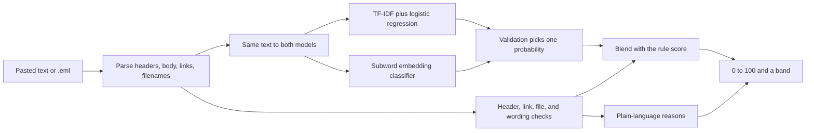

# Phish Check

A local tool that screens one email and explains the score in plain language. It is aimed at the messages a clinic front desk actually sees: claim and EOB notices, lab results, EHR password mail, payroll and benefits, vendor invoices, and fax or e-referral notes.

It runs on CPU. It does not call a paid API. It does not open links or attachments. A score is a screening aid for staff, not a decision about a patient and not a guarantee that a message is safe.

Sangeeta Sinha, VigilAI Solutions, built this. She holds Security+, CySA+, and CEH, and her background is healthcare operations and revenue cycle.

## Run it

```bash
python -m venv .venv
. .venv/bin/activate
pip install -r requirements.txt
pytest
python -m phishguard scan --eml examples/phishing_lure.eml
python -m phishguard serve
```

Then open http://127.0.0.1:8000 . Paste a message, upload a `.eml`, or use the two fictional examples. The server binds to `127.0.0.1`. Uploads are kept in memory, capped at 1 MB, and discarded.

Other commands:

```bash
python -m phishguard scan --text-file message.txt
python -m phishguard scan --eml examples/legitimate_notice.eml --json
python -m phishguard scan --eml examples/phishing_lure.eml --fail-over 60
python -m phishguard evaluate
```

`--fail-over 60` exits 1 when the score is at least 60, so a script can branch on it. A normal scan exits 0.

The checked-in model is enough for `scan`, `serve`, and `pytest`. Retraining is a separate step because the public mail is downloaded on your machine and is not in this repository.

## How a score is produced



The page and the CLI lead with the band and what to do. The reasons are the concrete checks that fired. A details section shows both model probabilities for IT.

| Score | Band | What the tool tells staff |
| --- | --- | --- |
| 0–29 | Low | No strong warning sign stood out. If the message was unexpected, still avoid links. |
| 30–59 | Needs a closer look | Check it before acting. Use a phone number you already have, not one from the email. |
| 60–79 | Suspicious | Do not click, open files, or reply. Send it to IT the way the clinic already does. |
| 80–100 | High risk | Treat it as phishing. Do not click, open, reply, or forward patient information. |

The blend is a noisy-or of the chosen model's probability and a rule score capped at 1. If the rule score is under 0.20, the wording probability is capped at 0.45 before the blend. A claim or a lab topic can sound like unwanted mail to a spam model. That should not, by itself, read as high risk. A look-alike domain, a reply address that does not match, or a dangerous attachment can raise the score even when the sentences are calm.

Rule weights are fixed in `src/phishguard/features.py`. They were not fit on the test set. They are not probabilities.

Checks, all offline:

- Look-alike domains, homoglyphs (`1` for `l`, and similar), and a brand name sitting on someone else's domain
- Reply-To on a different domain, with a stronger weight when that domain is a free mailbox
- A display name that sounds like a clinic, plan, or payroll office on a free mailbox
- IP addresses, punycode, `@` inside a URL, shorteners, very long host names, and `http://` links that talk about a sign-in or a payment
- Visible link text that names a different site than the href
- Attachments: programs, HTML files, macro-enabled Office files, double extensions such as `.pdf.exe`, and archives
- Urgency and shut-off language, password or sign-in language, and payment or bank-change language

The brand list includes real portals that clinics see (MyChart, Epic, large payers, lab companies, payroll vendors) and the fictional `.example` organizations used in the synthetic set. It is a starter list, not a directory of the industry.

## Two models

Both models see the same text: subject, From, Reply-To, attachment names, and the body, truncated at 6,000 characters.

**TF-IDF + logistic regression.** Word unigrams and bigrams (up to 30,000 features) unioned with character n-grams of length 3–5 inside word boundaries (up to 20,000 features). Logistic regression uses `class_weight="balanced"` and `liblinear`. This is the model the score uses. On the validation split it had the higher average of synthetic F1 and public F1.

**Subword embedding classifier.** A small model in the spirit of fastText: character n-grams of length 3–5, a learned 48-dimensional embedding, mean pooling, then a logistic layer. Trained with NumPy on CPU for 6 epochs. No pretrained transformer is downloaded. A transformer was a poor fit here: the useful comparison is against a strong sparse baseline, the training set is a few thousand short messages, and the project has to retrain on a laptop without a model hub.

Synthetic training rows are weighted 3× so the 600 fictional healthcare messages are not drowned by the public mail. Validation and test rows are not reweighted.

Each model gets one threshold, chosen to maximize F1 on the mixed validation split. The search is from 0.20 to 0.80. The test split is not used to pick the model or the threshold. At a tie, TF-IDF wins. Reported test numbers use that frozen threshold, and the tables also show 0.50 so the tuning is visible.

The positive class is "unwanted": SpamAssassin spam, Nazario phishing, and the synthetic healthcare phishing. The negative class is SpamAssassin ham plus the synthetic legitimate clinic mail. Spam and phishing are not the same thing. The slices below keep them apart.

## Dataset

| Source | What it is | In this run | License |
| --- | --- | --- | --- |
| Synthetic healthcare mail | 6 themes × 5 phishing templates × 5 legitimate templates × 10 filled-in variants | 600 (300 / 300) | MIT, with this project. Original writing. |
| SpamAssassin public corpus | `20030228` easy ham, easy ham 2, hard ham, spam, spam 2, and `20050311` spam 2 | 2,000 ham and 1,594 spam after dedupe and caps | The corpus is published for spam-filter testing. Copyright in the message text stays with the original senders. See the [corpus readme](https://spamassassin.apache.org/old/publiccorpus/readme.html). |
| Nazario phishing corpus | `20051114.mbox`, `phishing-2017`, `phishing-2019` | 734 messages after dedupe | [CC BY 4.0](https://creativecommons.org/licenses/by/4.0/). Jose Nazario, Phishing Corpus, https://monkey.org/~jose/phishing/ |

Total rows: 4,928. Splits: train 3,389, validation 553, test 986.

Synthetic templates are assigned to a split before any variant is filled in (3 train, 1 validation, 1 test inside each theme and class). A held-out healthcare message is not a renamed copy of a training template. Public rows are deduped on a hash of the normalized body, then split 70/10/20, stratified by source and label, with seed 42.

The synthetic organizations are fictional: Northwind Community Clinic, Lumen Health Plan, Cedar Lab Partners, Halcyon EHR, Marigold Benefits, Pike Street Billing, Riverbend Medical Group, and Westbridge Specialty. Links use the reserved `.example` domain. Phone numbers use the 555-0100 range. Attachment bodies in the example `.eml` files are a one-line placeholder, not a document and not a program. Messages that show one address in the text and another in the href are stored as HTML so the mismatch survives a real `.eml` parse.

Public message text is downloaded into `data/raw/` and the merged file is written to `data/processed/dataset.jsonl`. Both paths are gitignored.

```bash
python scripts/download_public.py
python scripts/build_dataset.py
python scripts/train.py
```

Do not point a live mail server at the SpamAssassin files. The corpus readme asks people not to do that, because bounce messages have hit real addresses.

## Held-out results

These numbers are from `reports/metrics.json`, produced by `python scripts/train.py` on the split above. They describe this collection. They are not a detection rate for a live mailbox.

### Language models on the test split

Thresholds were frozen on validation before this table was computed. TF-IDF's threshold is 0.44. The embedding model's is 0.49.

**TF-IDF + logistic regression** (this is the probability inside the staff score):

| Slice | Precision | Recall | F1 | Confusion matrix (tn, fp / fn, tp) |
| --- | --- | --- | --- | --- |
| All test, tuned threshold | 0.992 | 0.939 | 0.965 | 456, 4 / 32, 494 |
| All test, threshold 0.50 | 0.992 | 0.932 | 0.961 | 456, 4 / 36, 490 |
| Public test only | 0.991 | 0.989 | 0.990 | 396, 4 / 5, 461 |
| Synthetic healthcare only | 1.000 | 0.550 | 0.710 | 60, 0 / 27, 33 |

Other TF-IDF test cuts: false-positive rate on SpamAssassin ham 0.010 (4 of 400). Recall on Nazario phishing 1.000 (147 of 147). False-positive rate on synthetic legitimate mail 0. Recall on synthetic phishing 0.550 (33 of 60).

**Subword embedding:**

| Slice | Precision | Recall | F1 | Confusion matrix (tn, fp / fn, tp) |
| --- | --- | --- | --- | --- |
| All test, tuned threshold | 0.979 | 0.886 | 0.930 | 450, 10 / 60, 466 |
| All test, threshold 0.50 | 0.979 | 0.878 | 0.926 | 450, 10 / 64, 462 |
| Public test only | 0.978 | 0.953 | 0.965 | 390, 10 / 22, 444 |
| Synthetic healthcare only | 1.000 | 0.367 | 0.537 | 60, 0 / 38, 22 |

The linear model is ahead on every test slice above. That is why the score uses it. The embedding model is still a real second system: it learned from the same rows, and it is not a copy of the TF-IDF features. On this amount of mail, sparse n-grams were the stronger text model. Validation told the same story (TF-IDF F1 0.990, embedding F1 0.947), so the choice was not made by peeking at the test numbers.

The text model only recalls 33 of 60 held-out healthcare phish. Those templates were unseen. The rule checks are what carry the staff-facing score on that slice.

### Staff score at 60 or above

"Suspicious" or "High risk" is the positive decision here. The cutoff 60 was chosen as the band boundary up front. It was not tuned on the test set.

| Test slice | Precision | Recall | F1 | tn, fp / fn, tp | Mean score |
| --- | --- | --- | --- | --- | --- |
| All test | 0.955 | 0.363 | 0.526 | 451, 9 / 335, 191 | 38.8 |
| Synthetic healthcare | 1.000 | 0.967 | 0.983 | 60, 0 / 2, 58 | 51.9 |
| Public mail | 0.937 | 0.285 | 0.438 | 391, 9 / 333, 133 | 37.0 |

By category, share of test messages at or above 60:

| Category | Messages | Mean score | At or above 30 | At or above 60 | At or above 80 |
| --- | --- | --- | --- | --- | --- |
| Synthetic legitimate | 60 | 13.6 | 0 | 0 | 0 |
| Synthetic phishing | 60 | 90.2 | 60 | 58 | 50 |
| SpamAssassin ham | 400 | 8.7 | 31 | 9 | 0 |
| SpamAssassin spam | 319 | 56.2 | 319 | 63 | 60 |
| Nazario phishing | 147 | 72.1 | 147 | 70 | 70 |

Reading that table honestly: the staff score is strict. It catches 58 of 60 held-out fictional healthcare phish and flags none of the 60 fictional legitimate notes. The two it places under 60 are variants of one lab template whose only concrete signal was a Reply-To on a free mailbox; they scored 58 and 59, which is "needs a closer look," not "low." Nine of 400 ham messages from 2002–2005 reach 60. None reach 80.

It does **not** mark most old spam as suspicious. SpamAssassin spam is almost all at or above 30, so it shows up as "needs a closer look" or higher, but only about 20% reach 60. About half of the Nazario phishing messages reach 60, and every one of them reaches 30. The wording cap is why. A message with no look-alike, no reply mismatch, and no risky attachment tops out in the review band even when the language model is very sure. That is deliberate for a front desk. The language-model probability is still in the IT details, and the text-model table above is the right place to judge "did the classifier recognize old spam."

### A check that the healthcare mail is doing real work

TF-IDF trained only on the public rows, then scored on the synthetic test at 0.50, labeled every synthetic message unwanted. That includes all 60 legitimate clinic notes. Precision 0.50, recall 1.00, F1 0.667. Ordinary EOB and lab wording looked like spam to a model that had never been shown ordinary clinic mail.

The other direction, synthetic training rows only, scored on the public test at 0.50: precision 0.736, recall 0.633, F1 0.681 (294 true negatives, 106 false positives, 171 false negatives, 295 true positives). The fictional set is not a substitute for a public corpus, and the public corpus is not a substitute for the fictional set.

## Design choices

- The product question is "should the front desk stop?" The text-model question is "does this resemble mail labeled unwanted?" They are reported separately because a single F1 would blur them.
- Header and link checks never resolve DNS and never fetch a URL. Fetching a link from a suspicious message would be a server-side request to an untrusted host.
- Synthetic phishing is labeled and uses `.example`. It is training material for the detector, not a set of live lures.
- Legitimate templates use the same topics as the phishing templates, including deadlines and the word "password" in a reset notice that the user asked for. The separator is the domain, the reply address, and the attachment type, not the mere presence of "EOB" or "lab."
- Hard ham from SpamAssassin is included so HTML newsletters are in the legitimate class.
- `min_df=2` drops tokens that appear once. That reduces memorization of a single message and keeps one-off addresses out of the vocabulary.
- The web page escapes message text. It shows extracted text, not rendered HTML from the email.

## Limitations

- No live mailbox was reviewed. Nothing here is a measured false-alarm rate for a clinic.
- Held-out synthetic messages still share a small invented world with the training templates. A high score on that slice is evidence that the checks fire on these patterns. It is not evidence about attackers' next email.
- SpamAssassin mail is mostly 2002–2005. Nazario mail is real phishing as labeled by the corpus author, and it is not a healthcare collection. Language, brands, and infrastructure have changed.
- The positive public class mixes spam and phishing on purpose, and the metrics say which slice is which. A spam label is not a phishing label.
- Rule weights will false-alarm. Mailing lists often use a different Reply-To. A PDF is not treated as high risk by itself. Urgency language alone stays in a low weight.
- The brand list will miss organizations it does not contain, and it can flag a close spelling of a short name.
- Probabilities are not calibrated. The 0–100 score is a rank with a written blend, not "a 90% chance this is phishing."
- The tool does not inspect attachment bytes, macro source, or authentication results such as SPF, DKIM, or DMARC. Those headers are often stripped before a message is pasted.

## Tests

`pytest` covers parsing, the domain and attachment checks, the score blend, the synthetic split and the `.example` link rule, both models on a tiny separable set, the CLI exit code, HTML escaping, and the two shipped examples through the saved model and the web page.

## Layout

```
src/phishguard/    parser, checks, models, score, CLI, web page
data/synthetic/    fictional healthcare JSONL, committed
examples/          one fictional phish and one fictional clinic note
models/            trained joblib bundle
reports/metrics.json
scripts/           download, build, train
tests/
```

## License

Code, synthetic data, and this README are MIT. See `LICENSE`.

The SpamAssassin public corpus and the Nazario phishing corpus keep their own terms, summarized above. They are not relicensed by this repository, and their message text is not included in it.
